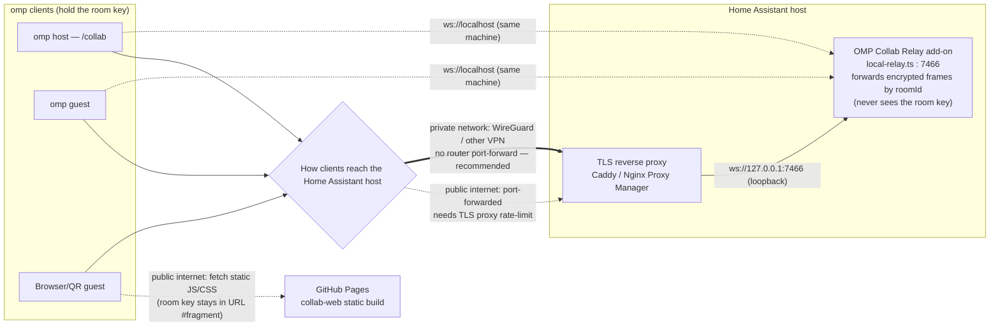

# OMP Collab Relay — Home Assistant Add-on

A Home Assistant add-on repository that runs [`oh-my-pi`](https://github.com/can1357/oh-my-pi)'s local collab relay — the documented, source-available WebSocket stand-in for the hosted `my.omp.sh` relay used by omp's `/collab` live session sharing. It lets an omp host and guest terminals exchange end-to-end-encrypted collab frames through a relay you run yourself, on port 7466.

**This add-on alone is not a drop-in replacement for `my.omp.sh`.** `local-relay.ts` is explicitly documented upstream as a stand-in for local/offline use: no TLS, no browser client (`GET /`), no `/share` blob endpoints, no `/healthz` — it only handles the `GET /r/<roomId>` WebSocket upgrade. Browser/QR joining needs a separately hosted copy of `packages/collab-web`'s static build, pointed at by `collab.webUrl`; this repository builds and publishes one via GitHub Pages (see [Self-hosting the browser client](#self-hosting-the-browser-client-optional) below), so relay and browser client can both be fully self-hosted with no third party involved anywhere. More importantly, both the omp CLI and the browser client validate relay URLs with the same rule: plain `ws://` is only accepted when the hostname is `localhost`, `127.0.0.1`, or `::1` — any other hostname must be `wss://`. This add-on does not terminate TLS itself.

In practice that means:

- **Same machine as omp** (or over a tunnel that presents as `localhost`): works unmodified, point omp at `ws://localhost:7466`.
- **Different machine than the omp client** (the normal case — this add-on runs on your Home Assistant host): you must front it with your own TLS reverse proxy (Nginx Proxy Manager, Caddy, Cloudflare Tunnel, Traefik, etc.) and point omp at the resulting `wss://` address. This add-on does not set that up for you.

## Architecture



The relay only ever sees encrypted frames tagged with a room ID — it pairs host and guest sockets for the same room and forwards bytes, nothing more. The room key that decrypts those frames is generated client-side and never transmitted to the relay; for browser/QR guests it travels only in the URL fragment after `#`, which browsers never send to a server.

The diamond marks the one place your network topology matters: clients reaching the Home Assistant host over a private network you control — WireGuard or another VPN, with no router port-forward — take the recommended path; see the "recommended default" note in [Fronting with TLS for remote access](#fronting-with-tls-for-remote-access). Port-forwarding the TLS proxy to the public internet instead also works, but needs the rate-limiting covered in [Hardening beyond TLS](#hardening-beyond-tls), since the relay has no auth of its own. Either way the connection terminates at `wss://`, not the relay's own `ws://` — the relay has no TLS, so the TLS reverse proxy sits in front of it regardless of whether the client is the omp CLI or a browser/QR guest. The one hop that's unconditionally public internet, independent of which network path you choose, is the static JS/CSS fetch from GitHub Pages for browser/QR guests — but that page never receives the room key, so it can't decrypt or join the session; it only renders the client that then connects to your relay.

## Add this repository

[](https://my.home-assistant.io/redirect/supervisor_add_addon_repository/?repository_url=https%3A%2F%2Fgithub.com%2Fkarl-petter%2Fomp-relay-server-ha-addon)

The badge above has a known upstream bug where the repository URL field sometimes doesn't pre-fill ([home-assistant/my.home-assistant.io#698](https://github.com/home-assistant/my.home-assistant.io/issues/698)). If that happens, add it manually:

1. Home Assistant → **Settings** → **Add-ons** → **Add-on store**.
2. ⋮ menu (top right) → **Repositories**.
3. Paste `https://github.com/karl-petter/omp-relay-server-ha-addon` and click **Add**.

## Install and start

Find **OMP Collab Relay** in the add-on store, click **Install**, then **Start**. The **Log** tab should show:

```
local collab relay listening on ws://localhost:7466
connect with /r/<roomId>?role=host|guest; Ctrl+C stops the relay
```

## Point omp at the relay

Set `collab.relayUrl` in omp's settings (see upstream [`docs/collab.md`](https://github.com/can1357/oh-my-pi/blob/main/docs/collab.md)):

- Same machine as the Home Assistant host (or localhost-presenting tunnel): `ws://localhost:7466`.
- Any other machine: `wss://<your-proxy-domain>`, pointed at this add-on's port 7466 through your own TLS-terminating reverse proxy.

Optionally also set `collab.webUrl` to a self-hosted copy of the browser client (see below) so the browser/QR link that `/collab` prints points at your own infrastructure instead of `my.omp.sh`.

Or, for a one-off session without changing the default: `/collab ws://<home-assistant-host>:7466` (or the `wss://` proxy address).

## Fronting with TLS for remote access

Plain `ws://` only works when omp and the relay are on the same machine (or a tunnel presenting as one) — anything else needs a TLS-terminating reverse proxy in front of port 7466, exposed to omp as `wss://`. Two documented ways to do that, both ordinary Supervisor-managed add-ons (installed from the Store, covered by Home Assistant's normal backup/restore, no host-OS changes required):

### Caddy, reusing a certificate you already have (recommended default)

If your Home Assistant install already has a certificate at `/ssl/fullchain.pem` and `/ssl/privkey.pem` — the standard location both the official **Let's Encrypt** add-on and the **DuckDNS** add-on write to — the [Caddy 2 add-on](https://github.com/einschmidt/hassio-addons) can reuse it directly on a new port, with no second certificate issuance and no GUI/database add-ons to install:

1. Add `https://github.com/einschmidt/hassio-addons` as a repository and install **Caddy 2** (don't start it yet).
2. Via the **Terminal & SSH** add-on (or **Samba**), find Caddy's config folder with `ls /addon_configs/` (named `<hash>_caddy-2`) and create a Caddyfile at `/addon_configs/<hash>_caddy-2/Caddyfile`:
   ```
   your-domain.example:7467 {
       tls /ssl/fullchain.pem /ssl/privkey.pem
       reverse_proxy localhost:7466
   }
   ```
   Replace `your-domain.example` with the hostname your existing certificate actually covers, and `7467` with any free port.
3. Set Caddy's **Configuration** tab to `non_caddyfile_config: {}`, `log_level: info`, `args: ["--watch"]`, `env_vars: []`, then **Start** it and check the Log tab for a clean startup with no ACME activity (it's using the static cert file, not requesting its own).
4. If `your-domain.example` doesn't already resolve privately to this host — e.g. you're reaching it over a plain public DNS name rather than a VPN with split-horizon DNS for it — forward the port you picked on your router, the same way you forward whatever port your existing certificate's service already uses.
5. Point omp at `wss://your-domain.example:7467`.

Reusing the existing certificate on a new port avoids a second Let's Encrypt certificate for the same hostname (Let's Encrypt rate-limits duplicate certs per domain to roughly 5/week) and needs no new add-on dependencies beyond Caddy itself.

### Nginx Proxy Manager (GUI, needs a database)

If you'd rather manage proxy rules through a web UI, or already run Nginx Proxy Manager for other services, install the **MariaDB** and **Nginx Proxy Manager** add-ons from the Store, add a Proxy Host forwarding to `omp-collab-relay:7466` with **Websockets Support** enabled, and let it issue its own certificate for a domain of your choice. The Home Assistant add-on wrapper requires MariaDB rather than SQLite (likely to avoid SQLite file-locking issues reported on Raspberry Pi), so this path has more moving parts than the Caddy option above.

### Hardening beyond TLS

The relay has no authentication of its own — a room ID and `role=host|guest` in the URL is all it checks. That's less exposed than it sounds: room IDs are high-entropy random strings (`generateRoomId()` upstream), not realistically guessable, and even a connection that does know a room ID can't decrypt anything or prompt the agent without the separate room *key*, which never reaches the relay — the host's own code rejects writes from anyone without it. What the relay has no defense against is a flood of connection attempts (valid or garbage room IDs alike): each one costs the relay a WebSocket handshake and a map lookup before being accepted or rejected, so if you forward this port to the public internet (rather than keeping it reachable only over a private network/VPN as in the Caddy walkthrough above), add a connection/request rate limit at whichever reverse proxy terminates TLS for you — Caddy's [`rate_limit`](https://caddyserver.com/docs/caddyfile/directives/rate_limit) directive or Nginx Proxy Manager's built-in rate limiting — since the relay itself has none.

## Self-hosting the browser client (optional)

`/collab` always prints a browser link alongside the terminal one, but this add-on's relay doesn't serve that client itself (see the limitation above). This repository publishes one anyway, independent of the add-on: `.github/workflows/pages.yml` builds `packages/collab-web`'s static output from the same pinned `oh-my-pi` release the relay vendors, strips the bundled third-party analytics script, and deploys it to GitHub Pages on every push to `main` — no container, nothing added to the Home Assistant host.

The room secret lives only in the URL fragment (the part after `#`), which browsers never send to the page's server by spec — GitHub Pages only ever serves the same static JS/CSS/HTML to every visitor; your actual session traffic goes straight from the browser to your relay over `wss://`, so this stays fully self-hosted end to end.

If you've forked this repository, enable it once under your fork's **Settings → Pages → Source: GitHub Actions** (not on by default on a fork), then point omp at it:

```
omp config set collab.webUrl https://<your-fork-owner>.github.io/<your-fork-name>
```

`/collab` then prints a browser link pointing at your own GitHub Pages site instead of `my.omp.sh`, with the relay connection itself still carried entirely by this add-on.

## Versioning

The add-on version always mirrors the exact upstream `oh-my-pi` release it vendors. A daily check compares the pinned release against upstream's latest, and only bumps and republishes when the relay/wire source itself actually changed.
